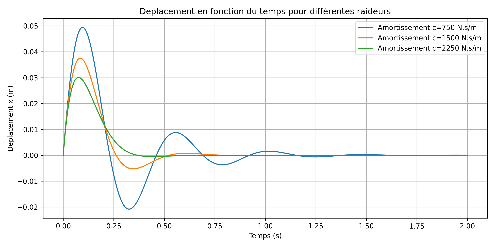
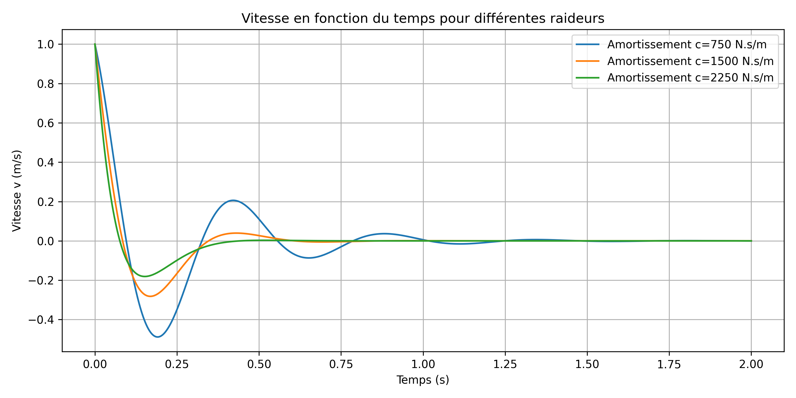
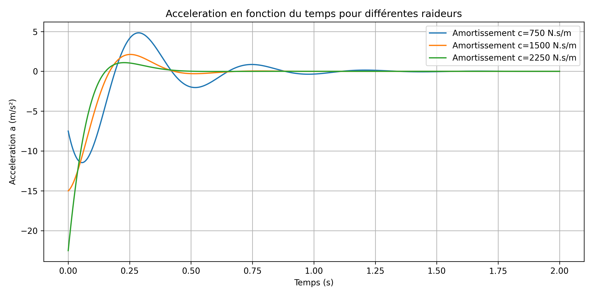
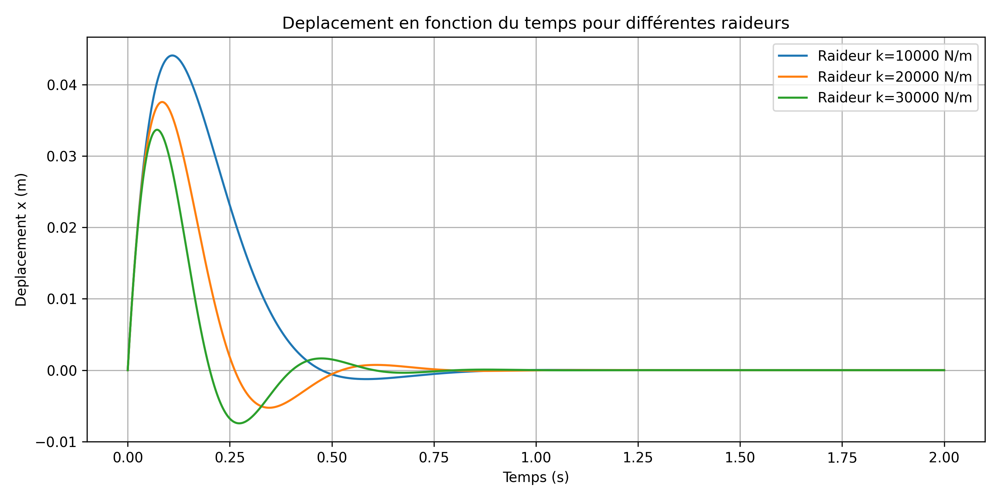
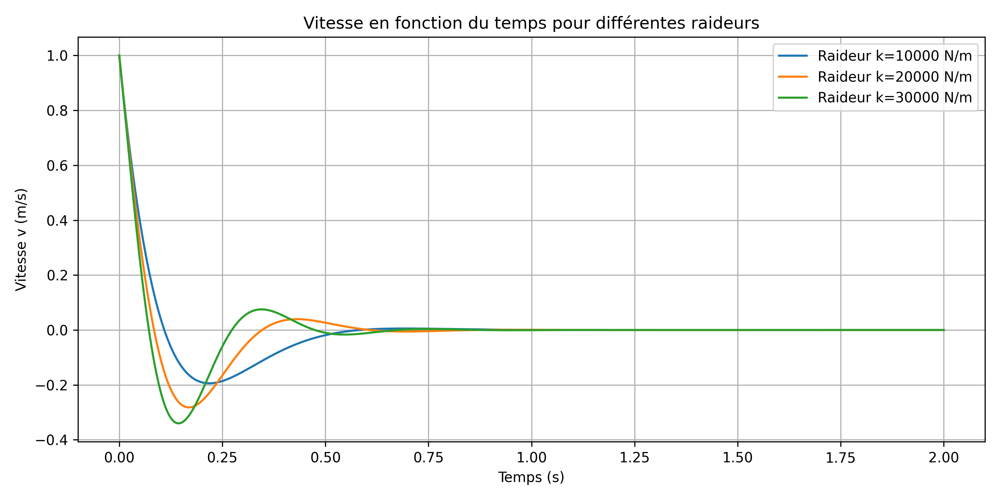
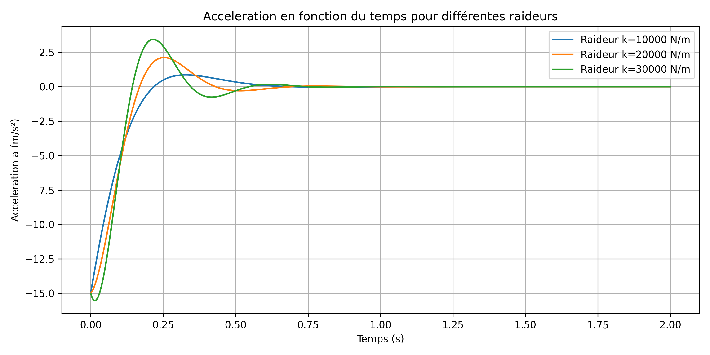

# Aircraft Landing Gear Dynamics

## Modélisation, résolution mathématique et analyse des résultats

# Partie I — 16–18 octobre 2026 : Modélisation mathématique et résolution de l'équation différentielle

## 1. Objectif de l'étude

L'objectif de cette première étape est de construire un modèle mécanique simplifié permettant d'étudier le comportement dynamique d'un amortisseur de train d'atterrissage d'avion.

Le système est représenté par une masse équivalente reliée à un ressort et à un amortisseur visqueux. Cette approche permet d'étudier les oscillations du système et de comprendre le rôle des paramètres mécaniques.

## 2. Principe physique du modèle

Le système étudié comporte trois éléments principaux :

- Une masse équivalente \(m\), représentant la masse supportée par le système.
- Un ressort de raideur \(k\), qui produit une force de rappel.
- Un amortisseur visqueux de coefficient \(c\), qui s'oppose au mouvement et dissipe de l'énergie.

Le déplacement \(x(t)\) est mesuré par rapport à la position d'équilibre statique. Le poids et les autres forces constantes sont ainsi pris en compte dans cette position d'équilibre.

En appliquant la deuxième loi de Newton, l'équation générale du mouvement s'écrit :

$$
m\ddot{x}+c\dot{x}+kx=F(t)
$$

Où :

- \(m\) est la masse équivalente, en kg ;
- \(c\) est le coefficient d'amortissement, en N·s/m ;
- \(k\) est la raideur du ressort, en N/m ;
- \(x(t)\), \(\dot{x}(t)\) et \(\ddot{x}(t)\) représentent respectivement le déplacement, la vitesse et l'accélération ;
- \(F(t)\) représente une force extérieure variable par rapport à l'équilibre.

Pour cette première étude, le système est considéré en oscillation libre, sans force extérieure supplémentaire après l'application des conditions initiales. L'équation devient :

$$
m\ddot{x}+c\dot{x}+kx=0
$$

## 3. Recherche de la fonction analytique \(x(t)\)

### 3.1. Équation caractéristique

Pour résoudre l'équation différentielle homogène, on recherche une solution de la forme :

$$
x(t)=e^{rt}
$$

En substituant cette expression dans l'équation du mouvement, on obtient :

$$
mr^2+cr+k=0
$$

Cette équation caractéristique permet de déterminer la nature de la réponse dynamique du système.

Son discriminant est :

$$
\Delta=c^2-4mk
$$

Trois régimes sont possibles :

- \(\Delta<0\) : régime sous-amorti, avec des oscillations amorties ;
- \(\Delta=0\) : régime d'amortissement critique ;
- \(\Delta>0\) : régime sur-amorti, sans oscillations.

### 3.2. Détermination de la solution

Lorsque \(\Delta<0\), les racines sont complexes :

$$
r_{1,2}=-\alpha\pm i\omega_d
$$

Avec :

$$
\alpha=\frac{c}{2m}
$$

Et :

$$
\omega_d=\sqrt{\frac{k}{m}-\alpha^2}
$$

La solution générale réelle est alors :

$$
x(t)=e^{-\alpha t}
\left[A\cos(\omega_dt)+B\sin(\omega_dt)\right]
$$

Les constantes \(A\) et \(B\) sont déterminées à partir des conditions initiales.

Pour le scénario étudié, les conditions initiales sont :

$$
x(0)=0,\qquad \dot{x}(0)=1\ \text{m/s}
$$

La première condition donne \(A=0\). En dérivant la fonction et en appliquant la seconde condition, on obtient :

$$
B=\frac{\dot{x}(0)}{\omega_d}
$$

La fonction analytique devient donc :

$$
x(t)=\frac{\dot{x}(0)}{\omega_d}
e^{-\alpha t}\sin(\omega_dt)
$$

Cette expression décrit un mouvement oscillatoire dont l'amplitude décroît avec le temps.

## 4. Application numérique

Les paramètres de référence retenus pour cette illustration sont :

| Paramètre | Valeur |
|---|---:|
| Masse équivalente \(m\) | 100 kg |
| Raideur \(k\) | 20 000 N/m |
| Coefficient d'amortissement \(c\) | 1 500 N·s/m |
| Déplacement initial \(x(0)\) | 0 m |
| Vitesse initiale \(\dot{x}(0)\) | 1 m/s |
| Durée de simulation | 2 s |

La pulsation propre non amortie est :

$$
\omega_n=\sqrt{\frac{k}{m}}
=\sqrt{\frac{20000}{100}}
\approx14{,}14\ \text{rad/s}
$$

Le coefficient d'amortissement critique vaut :

$$
c_{\mathrm{crit}} = 2\sqrt{mk}
$$

Avec les paramètres de référence :

$$
c_{\mathrm{crit}} = 2\sqrt{m \times k}
$$

En remplaçant les paramètres par leurs valeurs :

c_crit = 2 * sqrt(m * k)

Avec m = 100 kg et k = 20000 N/m :

c_crit = 2 * sqrt(100 * 20000) = 2828,43 N.s/m

Pour c = 1500 N.s/m :

alpha = c / (2 * m) = 1500 / (2 * 100) = 7,5 s^-1

omega_d = sqrt(k / m - alpha^2)

omega_d = sqrt(200 - 7,5^2) ≈ 11,99 rad/s

Le système est sous-amorti puisque c < c_crit.

La solution analytique correspondante est approximativement :

$$
x(t)=0{,}0834e^{-7{,}5t}\sin(11{,}99t)
$$

Le déplacement est exprimé en mètres et le temps en secondes.

**Remarque :** vérifier que ces paramètres et ces conditions initiales correspondent bien à ceux du script Python utilisé.

## 5. Résolution numérique avec Python

La résolution analytique permet de comprendre le comportement théorique du système. Pour réaliser des simulations paramétriques, l'équation différentielle est également résolue numériquement.

On introduit les variables d'état :

$$
x_1=x,\qquad x_2=\dot{x}
$$

Le système du second ordre est transformé en deux équations du premier ordre :

$$
\dot{x}_1=x_2
$$

$$
\dot{x}_2=-\frac{c}{m}x_2-\frac{k}{m}x_1
$$

Cette formulation est implémentée en Python. La fonction `solve_ivp` de SciPy est utilisée pour intégrer le système dans le temps. NumPy permet de manipuler les données numériques et Matplotlib de représenter les courbes obtenues.

Les principales grandeurs calculées sont :

- Le déplacement \(x(t)\).
- La vitesse \(\dot{x}(t)\).
- L'accélération \(\ddot{x}(t)\).

La simulation numérique permet de comparer plusieurs configurations mécaniques sans devoir résoudre manuellement l'équation différentielle pour chaque nouvelle valeur des paramètres.

## 6. Conclusion de la première étape

Cette première étape a permis d'établir le modèle mathématique, de déterminer la solution analytique dans le régime sous-amorti et de mettre en place une méthode de résolution numérique.

La solution analytique fournit une référence théorique pour vérifier la cohérence du programme Python. Le modèle constitue également une base pour étudier séparément l'influence de la raideur et de l'amortissement.

---

# Partie II — 19–21 octobre 2026 : Étude paramétrique et comparaison des résultats

## 1. Méthodologie de comparaison

L'objectif de cette deuxième étape est d'étudier l'influence des paramètres \(c\) et \(k\) sur la réponse dynamique du système.

Pour comparer les résultats correctement, un seul paramètre est modifié à la fois, tandis que les autres paramètres et les conditions initiales restent constants.

Les indicateurs retenus comprennent le déplacement maximal, la vitesse maximale, l'accélération maximale et le taux d'amortissement.

Ces indicateurs permettent de distinguer la réduction des déplacements de l'évolution des accélérations, qui ne réagissent pas nécessairement de la même manière.

## 2. Influence du coefficient d'amortissement \(c\)

### 2.1. Principe physique

L'amortisseur visqueux exerce une force opposée à la vitesse :

$$
F_c=-c\dot{x}
$$

Lorsque \(c\) augmente, la force d'amortissement devient plus importante pour une même vitesse. Le système dissipe alors davantage d'énergie mécanique au cours du mouvement.

Le taux d'amortissement est défini par :

$$
\zeta=\frac{c}{2\sqrt{mk}}
=\frac{c}{c_{\mathrm{crit}}}
$$

Pour une masse et une raideur constantes, l'augmentation de \(c\) augmente donc le taux d'amortissement.

### 2.2. Comparaison des résultats numériques

Les simulations réalisées pour plusieurs valeurs de \(c\) permettent de comparer les indicateurs suivants :

| \(c\) (N·s/m) | x_max (m) | Accélération maximale absolue (m/s²) | zeta |
|---:|---:|---:|---:|
| 750 | 0,049422 | 11,456879 | 0,2652 |
| 1 500 | 0,037549 | 15,000000 | 0,5303 |
| 2250 | 0.030084 | 22.500000 | 0.7955 |

Les deux premières lignes reprennent les résultats disponibles. Les autres cas seront ajoutés à partir de la sortie complète du programme.

### 2.3. Analyse des résultats

Entre \(c=750\) et \(c=1500\ \text{N·s/m}\), le déplacement maximal passe de 0,049422 m à 0,037549 m.

Cela correspond à une diminution d'environ 24 % du déplacement maximal. Ce résultat indique que, dans les configurations simulées, l'augmentation de l'amortissement limite le déplacement de la masse.

En revanche, l'accélération maximale en valeur absolue passe de 11,456879 à 15 m/s². Elle ne diminue donc pas dans cette comparaison.

Ce comportement peut être expliqué par l'équation du mouvement :

$$
\ddot{x}=-\frac{c}{m}\dot{x}-\frac{k}{m}x
$$

À l'instant initial, puisque \(x(0)=0\) et \(\dot{x}(0)=1\ \text{m/s}\), l'accélération vaut :

$$
\ddot{x}(0)=-\frac{c}{m}
$$

Elle vaut ainsi -7,5 m/s² pour \(c=750\) et -15 m/s² pour \(c=1500\ \text{N·s/m}\). Cette dernière valeur correspond à l'accélération initiale et à la valeur absolue maximale rapportée par la simulation.

L'étude montre donc qu'un amortissement plus important peut réduire le déplacement tout en augmentant l'accélération maximale. Le choix du coefficient d'amortissement doit prendre en compte plusieurs critères.

## 3. Influence de la raideur du ressort \(k\)

### 3.1. Principe physique

Le ressort exerce une force de rappel proportionnelle au déplacement :

$$
F_k=-kx
$$

Une augmentation de la raideur signifie que le ressort oppose une force plus importante à déplacement égal.

La pulsation propre non amortie est :

$$
\omega_n=\sqrt{\frac{k}{m}}
$$

À masse constante, une augmentation de \(k\) augmente la pulsation propre et la fréquence des oscillations.

Pour un système sous-amorti, la pulsation amortie vaut :

$$
\omega_d=\sqrt{\frac{k}{m}-\left(\frac{c}{2m}\right)^2}
$$

Lorsque \(m\) et \(c\) sont constants, une augmentation de \(k\) augmente également \(\omega_d\), tant que le système reste sous-amorti.

### 3.2. Comparaison des courbes

Les courbes de déplacement, de vitesse et d'accélération sont utilisées pour comparer les différentes valeurs de raideur.

| k (N/m) | x_max (m) | Accélération maximale absolue (m/s²) | Zeta |
|---:|---:|---:|---:|
| 10000 | 0.044065 | 15.000000 | 0.7500 |
| 20000 | 0.037549 | 15.000000 | 0.530|
| 30000 | 0.033663 | 15.52839 | 0.4330|

Les valeurs exactes doivent être extraites des simulations Python avant de tirer une conclusion quantitative.

### 3.3. Analyse des résultats

Les courbes obtenues permettent d'observer comment la raideur modifie l'amplitude et la fréquence du mouvement.

Une raideur plus élevée augmente la fréquence propre du système. Cependant, son effet sur le déplacement maximal et l'accélération maximale dépend des conditions initiales et de l'amortissement.

Il est donc nécessaire de distinguer les observations graphiques des conclusions quantitatives. Les valeurs maximales doivent être extraites du même intervalle de simulation et calculées selon la même méthode pour chaque configuration.

## 4. Comparaison générale entre \(c\) et \(k\)

Les deux études paramétriques mettent en évidence des rôles physiques différents.

| Paramètre | Effet physique principal | Indicateurs à examiner |
|---|---|---|
| Coefficient d'amortissement \(c\) | Dissipation d'énergie et atténuation des oscillations | Déplacement maximal, accélération maximale, décroissance des oscillations |
| Raideur \(k\) | Force de rappel et fréquence propre | Déplacement, vitesse, accélération, fréquence des oscillations |

Le coefficient d'amortissement agit directement sur la dissipation d'énergie. La raideur détermine principalement la rigidité du système et contribue à fixer sa fréquence propre.

Les résultats obtenus montrent qu'il n'existe pas un seul indicateur suffisant pour caractériser la réponse du système. Une réduction du déplacement maximal ne garantit pas nécessairement une réduction de l'accélération maximale.

## 5. Conclusion générale

Le modèle masse–ressort–amortisseur à un degré de liberté permet d'étudier de manière simplifiée le comportement dynamique d'un amortisseur de train d'atterrissage.

La première étape a permis d'établir l'équation différentielle, de déterminer la solution analytique et de développer une résolution numérique avec Python.

La deuxième étape a permis d'étudier séparément l'influence du coefficient d'amortissement \(c\) et de la raideur \(k\).

Pour les deux valeurs de \(c\) présentées, l'augmentation de l'amortissement réduit le déplacement maximal, mais augmente l'accélération maximale rapportée. Ce résultat illustre l'importance d'une analyse multicritère.

L'étude de \(k\) doit être complétée par les valeurs numériques extraites des simulations afin de quantifier son influence sur le déplacement, la vitesse et l'accélération.

Enfin, le modèle actuel reste une approximation linéaire à un degré de liberté. Il ne représente pas encore tous les phénomènes d'un train d'atterrissage réel, notamment les non-linéarités de l'amortisseur, les variations de charge, les contacts pneu-piste et les mouvements couplés du train.

Les prochaines étapes consisteront à finaliser les tableaux comparatifs, à vérifier la cohérence des résultats et à envisager une comparaison avec MATLAB/Simulink.

---

*Projet en cours de développement — résultats à compléter à partir des simulations finales.*